# ECS1 End-Semester Project: Combinational and Sequential Logic Design

End-semester project for **Elements of Computing Systems 1** (B.Tech in Artificial Intelligence, Amrita School of Engineering, Bangalore, February 2022). It has two parts built on the [Nand2Tetris](https://www.nand2tetris.org/) toolchain:

1. Implementing four Boolean functions with exactly **three half adders** (HDL, simulated in the Nand2Tetris Hardware Simulator).
2. Designing a **4-bit synchronous binary up counter** from **T flip-flops** (state diagram, K-maps and circuit).

The full write-up is in [`docs/ECS1-End-Sem-Report.docx`](docs/ECS1-End-Sem-Report.docx).

## Repository structure

```text
.
├── hdl/
│   ├── ThreeHalfAdders.hdl   # Question 1: D, E, F, G from three half adders
│   └── AND3.hdl              # Helper: 3-input AND gate
├── docs/
│   ├── ECS1-End-Sem-Report.docx
│   └── images/               # Derivations, diagrams and simulator screenshots
└── README.md
```

## Question 1: Four Boolean functions using three half adders

**Problem.** Implement the following functions using three half-adder circuits.

| Output | Function |
|:-:|:--|
| D | A ⊕ B ⊕ C |
| E | A'BC + AB'C |
| F | ABC' + (A' + B')C |
| G | ABC |

### Approach

A half adder computes `sum = x ⊕ y` and `carry = x · y`. Simplifying the functions shows each one is a half-adder output:

- **E** = A'BC + AB'C = (A ⊕ B) · C
- **F** = ABC' + (A' + B')C = (AB)C' + (AB)'C = (A · B) ⊕ C, using De Morgan's theorem (A' + B' = (AB)')
- **G** = ABC = (A · B) · C

| Half adder | Inputs | Sum | Carry |
|:-:|:--|:--|:--|
| HA1 | A, B | A ⊕ B | AB |
| HA2 | A ⊕ B, C | **D** = A ⊕ B ⊕ C | **E** = (A ⊕ B)C |
| HA3 | C, AB | **F** = (AB) ⊕ C | **G** = ABC |

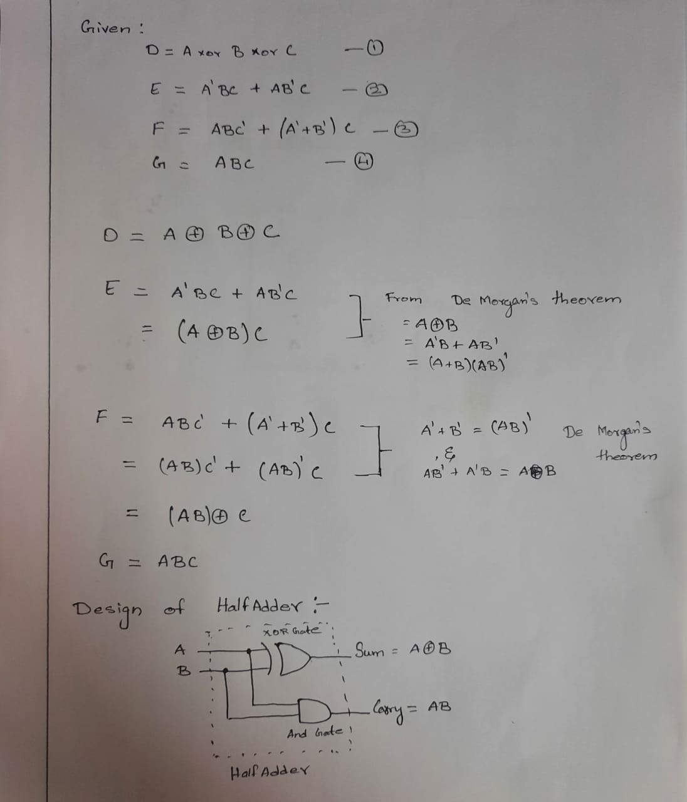

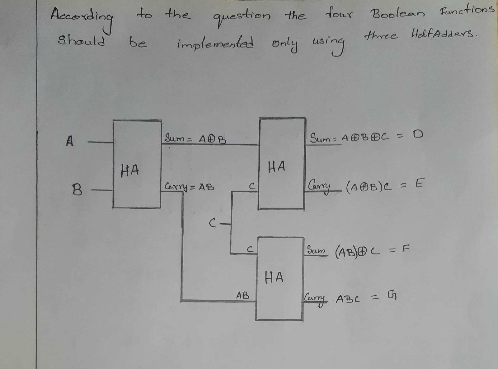

### HDL

[`hdl/ThreeHalfAdders.hdl`](hdl/ThreeHalfAdders.hdl) (uses the built-in `HalfAdder` chip):

```hdl
CHIP ThreeHalfAdders {
    IN  a, b, c;
    OUT d, e, f, g;

    PARTS:
    HalfAdder(a=a,     b=b,  sum=axorb, carry=ab);
    HalfAdder(a=axorb, b=c,  sum=d,     carry=e);
    HalfAdder(a=c,     b=ab, sum=f,     carry=g);
}
```

### Truth table

| A | B | C | D | E | F | G |
|:-:|:-:|:-:|:-:|:-:|:-:|:-:|
| 0 | 0 | 0 | 0 | 0 | 0 | 0 |
| 0 | 0 | 1 | 1 | 0 | 1 | 0 |
| 0 | 1 | 0 | 1 | 0 | 0 | 0 |
| 0 | 1 | 1 | 0 | 1 | 1 | 0 |
| 1 | 0 | 0 | 1 | 0 | 0 | 0 |
| 1 | 0 | 1 | 0 | 1 | 1 | 0 |
| 1 | 1 | 0 | 0 | 0 | 1 | 0 |
| 1 | 1 | 1 | 1 | 0 | 0 | 1 |

### Simulation

Hardware Simulator runs for three input combinations (the internal pins `d`, `e`, `f`, `g` match the table above):

| A = 1, B = 0, C = 1 | A = 0, B = 1, C = 1 | A = 1, B = 1, C = 1 |
|:-:|:-:|:-:|
| 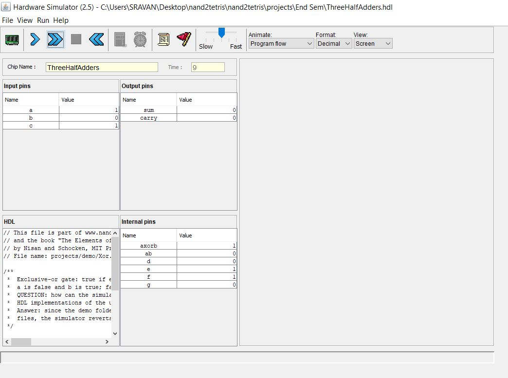 | 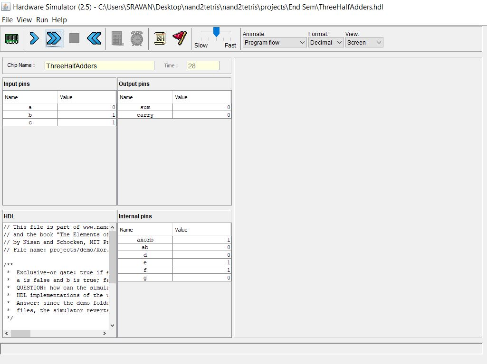 | 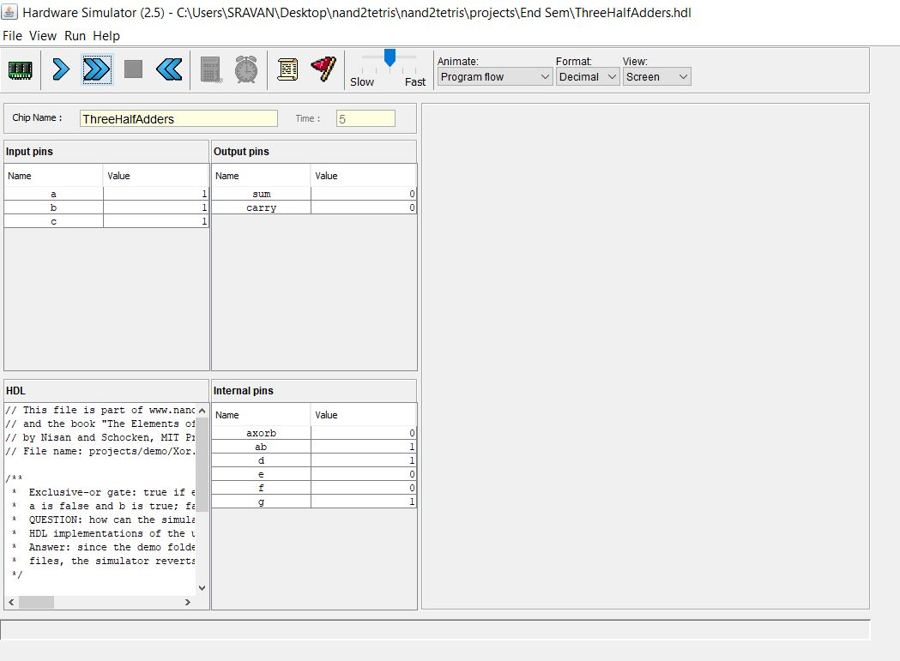 |

> The screenshots were taken with an earlier revision of the HDL file in which `d`–`g` were internal pins. The current file exposes them as the outputs `d`, `e`, `f`, `g`.

## Question 2: 4-bit binary up counter using T flip-flops

**Problem.** Explain the 4-bit binary up counter and implement it using T flip-flops.

### Step 1: Bits and flip-flop

A 4-bit counter has 2⁴ = 16 states (0000 to 1111) and needs four T flip-flops, named A, B, C, D (A is the most significant bit). After 1111 it wraps back to 0000.

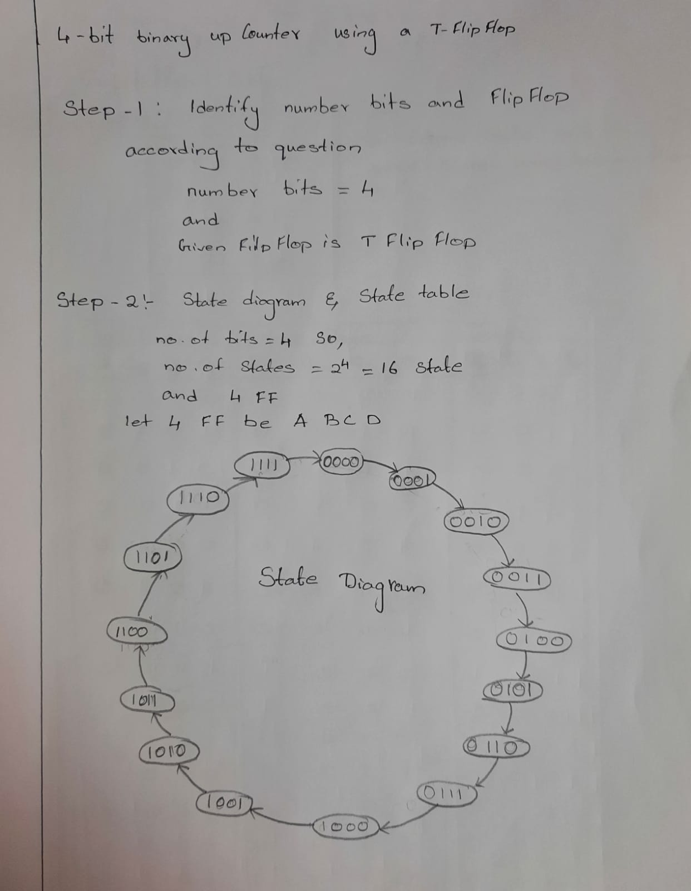

### Step 2: Excitation table and state table

A T flip-flop toggles when `T = 1` and holds when `T = 0`, so `T = Qn ⊕ Qn+1`.

| Qn | Qn+1 | T |
|:-:|:-:|:-:|
| 0 | 0 | 0 |
| 0 | 1 | 1 |
| 1 | 0 | 1 |
| 1 | 1 | 0 |

| Present state |  |  |  | Next state |  |  |  | Flip-flop inputs |  |  |  |
|:-:|:-:|:-:|:-:|:-:|:-:|:-:|:-:|:-:|:-:|:-:|:-:|
| **QA** | **QB** | **QC** | **QD** | **QA+** | **QB+** | **QC+** | **QD+** | **TA** | **TB** | **TC** | **TD** |
| 0 | 0 | 0 | 0 | 0 | 0 | 0 | 1 | 0 | 0 | 0 | 1 |
| 0 | 0 | 0 | 1 | 0 | 0 | 1 | 0 | 0 | 0 | 1 | 1 |
| 0 | 0 | 1 | 0 | 0 | 0 | 1 | 1 | 0 | 0 | 0 | 1 |
| 0 | 0 | 1 | 1 | 0 | 1 | 0 | 0 | 0 | 1 | 1 | 1 |
| 0 | 1 | 0 | 0 | 0 | 1 | 0 | 1 | 0 | 0 | 0 | 1 |
| 0 | 1 | 0 | 1 | 0 | 1 | 1 | 0 | 0 | 0 | 1 | 1 |
| 0 | 1 | 1 | 0 | 0 | 1 | 1 | 1 | 0 | 0 | 0 | 1 |
| 0 | 1 | 1 | 1 | 1 | 0 | 0 | 0 | 1 | 1 | 1 | 1 |
| 1 | 0 | 0 | 0 | 1 | 0 | 0 | 1 | 0 | 0 | 0 | 1 |
| 1 | 0 | 0 | 1 | 1 | 0 | 1 | 0 | 0 | 0 | 1 | 1 |
| 1 | 0 | 1 | 0 | 1 | 0 | 1 | 1 | 0 | 0 | 0 | 1 |
| 1 | 0 | 1 | 1 | 1 | 1 | 0 | 0 | 0 | 1 | 1 | 1 |
| 1 | 1 | 0 | 0 | 1 | 1 | 0 | 1 | 0 | 0 | 0 | 1 |
| 1 | 1 | 0 | 1 | 1 | 1 | 1 | 0 | 0 | 0 | 1 | 1 |
| 1 | 1 | 1 | 0 | 1 | 1 | 1 | 1 | 0 | 0 | 0 | 1 |
| 1 | 1 | 1 | 1 | 0 | 0 | 0 | 0 | 1 | 1 | 1 | 1 |

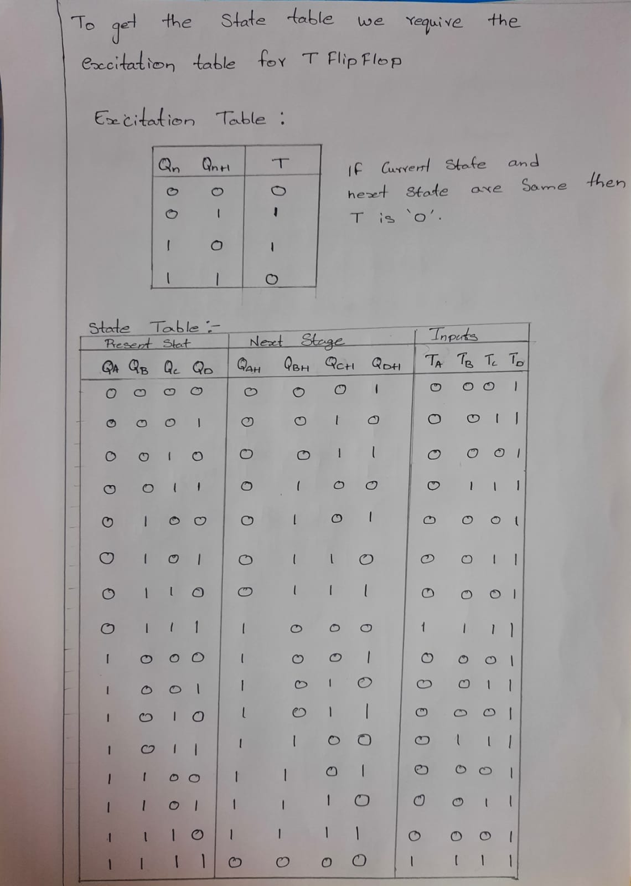

### Step 3: Simplification with K-maps

From the state table, the minterms where each input is 1 are:

- TA = Σm(7, 15)
- TB = Σm(3, 7, 11, 15)
- TC = Σm(1, 3, 5, 7, 9, 11, 13, 15)
- TD = Σm(0 to 15)

| TA | TB |
|:-:|:-:|
| 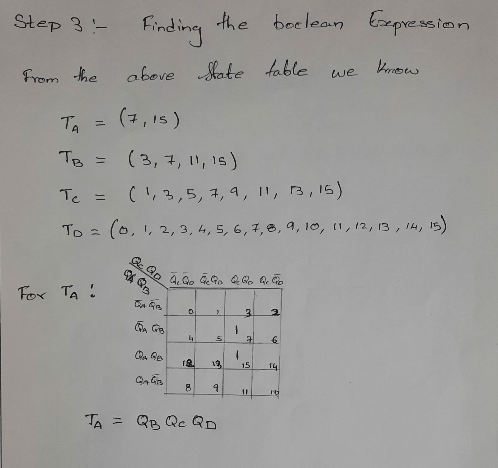 | 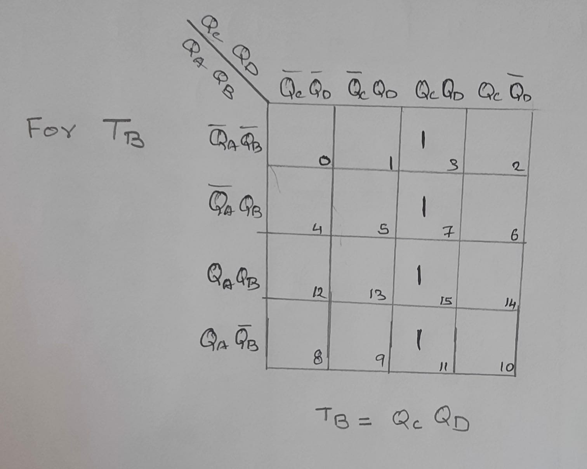 |

| TC | TD |
|:-:|:-:|
| 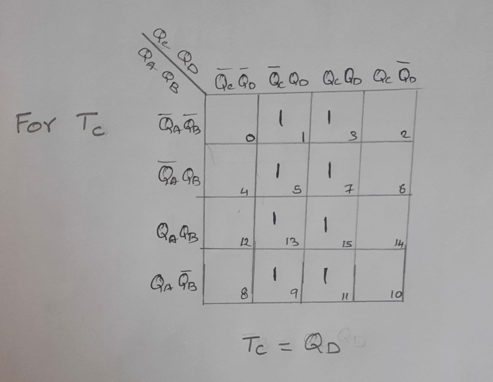 | 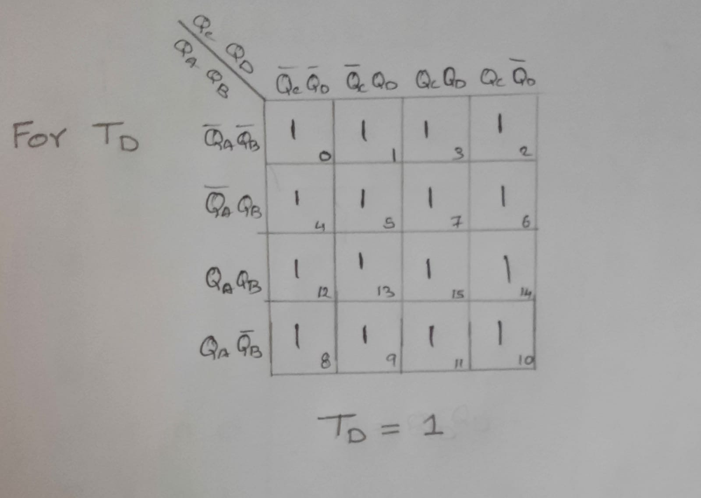 |

### Step 4: Circuit

| Input | Expression |
|:-:|:--|
| TD | 1 |
| TC | QD |
| TB | QC · QD |
| TA | QB · QC · QD |

Each flip-flop toggles only when all lower-order bits are 1, which is exactly binary counting. All four flip-flops share the same clock. The circuit uses two AND gates (QC·QD and QB·QC·QD).

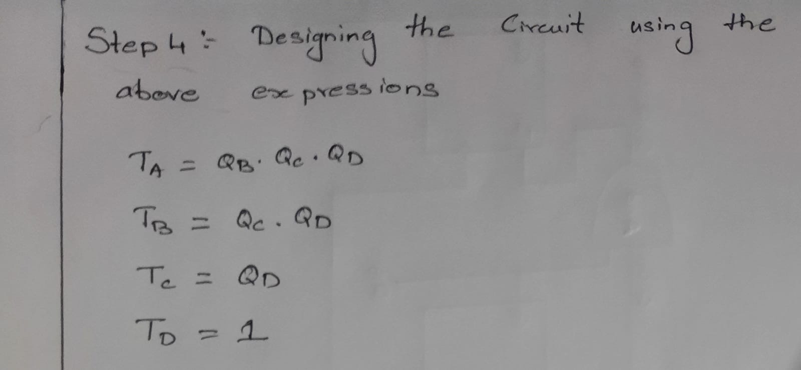

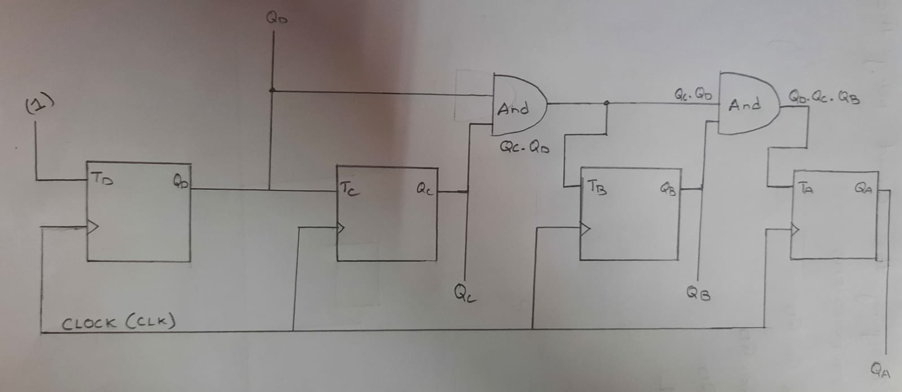

> Question 2 is a paper design. The report does not include an HDL implementation of this counter.

## Running the HDL

1. Download the [Nand2Tetris software suite](https://www.nand2tetris.org/software).
2. Open the **Hardware Simulator** and load `hdl/ThreeHalfAdders.hdl`.
3. Set the `a`, `b`, `c` input pins and step through. Check `d`, `e`, `f`, `g` against the truth table above.

## Author

**Siddhartha Mettu**: [GitHub](https://github.com/Siddhartha80) · [LinkedIn](https://www.linkedin.com/in/siddhartha-mettu/)
